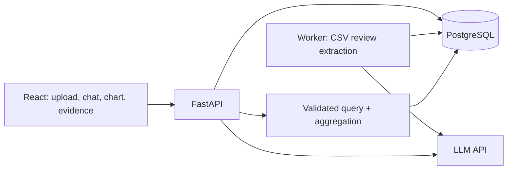

# Review Intelligence — MVP Technical Design

Thiết kế triển khai [features_and_scope.md](features_and_scope.md). `fe/` hiện là frontend Vite mẫu; chưa có backend hoặc chức năng sản phẩm. Không có timeline; các giới hạn kích thước/batch là cấu hình khởi đầu cần đo.

## Thứ tự task cho PI Code

Các task dưới đây là **kế hoạch bàn giao, chưa cho phép implement code**. Mỗi task chỉ bắt đầu sau khi người dùng duyệt danh sách feature theo AGENTS.md. Đi theo một luồng dọc trước; mỗi task phải để lại phần chạy/kiểm tra được, không tạo lớp hoặc service để dành.

| Task | Phạm vi giao PI Code | Xong khi |
| --- | --- | --- |
| P0 — chốt dữ liệu đầu vào | Kiểm tra một CSV mẫu có `brand,text`, chọn hai brand và khoảng 20–50 review son dưỡng; xác định provider/model cho bản thử và cách cấp key ở backend. Chỉ chuẩn bị dữ liệu/cấu hình, không đưa gold label vào input. | Có fixture nhỏ, schema cột và ví dụ expected output để các task sau dùng chung. |
| P1 — CSV → review | Tạo FastAPI, PostgreSQL schema tối thiểu và endpoint preview/import cho **một CSV**. Kiểm tra UTF‑8/BOM, quote/newline, cột trùng, giới hạn và brand; lưu review cùng filename/record number. | Upload CSV mẫu trả lỗi đúng dòng, lưu đúng số review, reload đọc lại được; test parser và validation. |
| P2 — review → mention | Gọi một model qua backend để phân tích relevance, brand, aspect, sentiment, evidence; validate output trước khi lưu. Chạy job ngoài request với trạng thái tối thiểu để UI poll. | Job hoàn thành trên fixture, lỗi model không tạo mention giả, evidence trỏ về text gốc; test schema và trạng thái lỗi. |
| P3 — mention → facts/chart/evidence | Thêm truy vấn có tham số cho một câu so sánh A/B theo aspect; trả grouped bar, mẫu số/coverage và danh sách review phân trang theo cùng filter. Chưa cần LLM tạo câu trả lời tự do. | Tử số/mẫu số trên chart khớp tập review mở từ chart, không nhân đôi mention và không đếm review lạc đề; test aggregation/drill-down. |
| P4 — giao diện luồng dọc | Thay màn Vite mẫu bằng upload/preview, tiến độ, câu hỏi mẫu, chart và review explorer. Chỉ dùng payload từ API cho số liệu/citation. | Người dùng đi hết một CSV → phân tích → chart → mở review trên localhost; `npm run build` và `npm run lint` đạt. |
| P5 — hoàn thiện MVP | Thêm demo ViLipBTA, hai CSV/gán brand, bốn intent và follow-up, lưu chat, retry/idempotency, cost/benchmark và giới hạn truy cập khi host theo các mục còn lại của tài liệu. Chia P5 thành task nhỏ sau khi P1–P4 được nghiệm thu. | Đạt các tiêu chí ở mục Nghiệm thu MVP của scope; không tự triển khai Azure trước khi có quyết định host. |

P0 cần kiểm tra lại giấy phép và cấu trúc thật của demo ViLipBTA; nếu dữ liệu không có brand nguồn tin cậy thì giữ demo cho P5 như scope đã mô tả. P1–P4 không phụ thuộc DataLens hoặc khả năng upload CSV của bản DataLens open source. Tham khảo DataLens ở ranh giới connection/dataset/chart và cách drill-down, không đưa PostgreSQL metadata service, Temporal hoặc Highcharts vào stack này.

## 1. Tham khảo gì từ sơ đồ IBL?

Sơ đồ [Architecture-Diagram.png](G:/road_to_web/fpt/IBLdocs/IBL/Architecture-Diagram.png) thể hiện một hệ hỏi đáp trên file với React, FastAPI, dữ liệu quan hệ, ingest/indexing, chat và citations. Bảng dưới là cách chuyển các pattern nhìn thấy sang MVP; không khẳng định sơ đồ đã có worker/retry hay triển khai thực tế theo một cách cụ thể.

| Trong sơ đồ | Áp dụng cho Review Intelligence |
| --- | --- |
| React → REST → FastAPI | Giữ cùng ranh giới frontend/backend; UI không giữ API key model. |
| Workspace/file status | Một analysis có nguồn file, cấu hình, trạng thái, tiến độ và lỗi. Một workspace demo, chưa cần folder tree/membership. |
| Upload rồi index, chat sau | Tách ingest review khỏi chat; phân tích một lần rồi dùng kết quả đã lưu. |
| Chat session/history | Lưu message và filter state để câu hỏi tiếp nối không đổi phạm vi ngoài ý muốn. |
| Answer + citations | Mọi evidence giữ review_id, import filename và CSV record number. |
| SQL Server lưu metadata/history | Dùng PostgreSQL đang được chọn; không cần đổi DB để giống sơ đồ. |
| Chunk + embed + top-k | Thay bằng parse CSV + structured extraction + SQL aggregation trong core. Top-k không đủ cho thống kê toàn tập. |
| Document Intelligence | Chưa cần vì CSV đã có text; chỉ xét khi mở PDF/scan. |
| Blob + Event Grid | Chưa cần: một API import ghi dữ liệu/job vào DB; sau này mới tách raw-file storage và event ingestion. |
| Entra ID | Học ranh giới xác thực; bản host giới hạn người demo qua auth sẵn có của Azure, chưa tự viết SSO/membership. |
| Các khối LLM summarize/chat/embed | Là các trách nhiệm khác nhau; không bắt buộc ba model hay ba service. MVP dùng một model cho extraction/plan/synthesis. |

Khác biệt chính: IBL truy hồi đoạn văn để trả lời; Review Intelligence phải tính thống kê review trước, rồi mới diễn giải bằng LLM. Bằng chứng và số tổng cần cùng scope.

## 2. Stack và kiến trúc MVP

| Thành phần | Chọn |
| --- | --- |
| Frontend | React + TypeScript + Vite; Recharts cho hai nhóm chart cột |
| Backend | FastAPI + Pydantic; Python csv cho input |
| Database | PostgreSQL + SQLAlchemy + Alembic |
| Xử lý nền | Một worker Python, job/batch lưu trong PostgreSQL |
| Model | Một LLM API có structured JSON; provider chọn sau benchmark tiếng Việt/chi phí |
| Local | React dev server, API, PostgreSQL và worker |
| Azure tùy chọn | Container Apps cho API/worker, PostgreSQL Flexible Server; React build có thể phục vụ cùng API |



API và worker là hai process trong cùng codebase, không phải hệ microservice. Chưa cần Redis, Service Bus, vector database, agent framework hoặc WebSocket.

## 3. Hai luồng độc lập

### Ingest

Upload → parse/validate → preview và xác nhận mapping → lưu review/job → worker xử lý batch → validate output → lưu mention và status.

Không để request upload chờ tất cả model calls. API trả analysis_id để UI poll tiến độ. Không chỉ giữ job bằng FastAPI BackgroundTasks/in-memory, vì restart sẽ mất dấu tác vụ.

### Chat

Câu hỏi + filter state → LLM tạo plan có cấu trúc → backend validate → SQL lấy số liệu/review → LLM viết đoạn diễn giải ngắn → React render chart và citations.

Chart dùng facts do backend tính, không nhận ảnh/code chart do model sinh. Citation giữ ID nguồn, không dùng model tự tạo URL.

## 4. Dữ liệu tối thiểu

| Bảng | Trường/trách nhiệm chính |
| --- | --- |
| analyses | Hai brand + alias được xác nhận, preset aspect/version, mapping/input hash, model/prompt, status, usage |
| batches | analysis_id, row scope, lease/attempts/status/error |
| reviews | analysis_id, filename/CSV record number, source ID, source brand nếu biết, text/context, relevance/processing status |
| mentions | review_id, target brand hoặc General/other/unresolved, aspect, sentiment, evidence |
| messages | analysis_id, role, text, plan/filter state, facts/chart, evidence IDs và version |

Giữ mỗi analysis độc lập. Chưa có bảng organizations, memberships, reports, corrections hoặc issue tracker. Mở lại lịch sử chat là mở lại message payload đã lưu; không cần một cơ chế snapshot report riêng.

Source brand là metadata nguồn; target brand nằm ở mention. Một comment nhắc nhiều brand có thể sinh nhiều mention. Không coi video_id của demo là một brand.

Output đã lưu không bị sửa trong MVP; muốn chạy lại tạo analysis mới. Khi tóm tắt một phần batch thành công, message phải ghi đúng tập review hoàn thành tại thời điểm query, không đổi theo các batch đến sau.

## 5. CSV và cấu hình giới hạn

- Một CSV có brand column hoặc hai CSV gán source brand theo file.
- Demo có adapter text/context từ ViLipBTA; không nạp gold brand/aspect/sentiment làm input dự đoán.
- UTF‑8/UTF‑8 BOM, header, phẩy, hỗ trợ ô nhiều dòng/ngoặc kép.
- Tối đa 2 MiB/file, hai file, 500 data records/analysis; text 2.000 ký tự và context 1.000 ký tự.
- Giới hạn byte trước khi đọc toàn bộ. Header trùng, row sai cấu trúc, text rỗng/quá dài phải báo vị trí; không cắt ngầm.
- Dữ liệu source ID trùng cần thông báo. Không tự xóa text giống nhau.
- Client preview không thay server validation; chỉ các cột đã chọn mới được gửi model.
- Vượt giới hạn số bản ghi thì từ chối trước model calls; không tự lấy 500 dòng đầu.
- Không parse ngày cho chart thời gian trong MVP; không tự dùng ngày upload như ngày review.

Các ngưỡng này cấu hình phía server và hiển thị trước khi chạy. Cần kèm ngân sách token/spend cho analysis và giới hạn request/chat; không coi file nhỏ chắc chắn có chi phí nhỏ.

## 6. Extraction contract

```json
{
  "review_id": "r12",
  "relevance": "relevant",
  "mentions": [
    {
      "target_brand": "brand_a",
      "aspect": "Benefits",
      "sentiment": "Positive",
      "evidence": "Dưỡng ẩm tốt"
    },
    {
      "target_brand": "brand_a",
      "aspect": "Texture",
      "sentiment": "Negative",
      "evidence": "hơi dính"
    }
  ]
}
```

Ví dụ text gốc: “Dưỡng ẩm tốt nhưng hơi dính”. Target trên chỉ hợp lệ khi source metadata/context đủ căn cứ gán A.

Relevance: relevant / off_topic / needs_review. Target: một trong hai brand đã chọn hoặc các trạng thái General/other/unresolved được định nghĩa rõ. Aspect thuộc 10 nhãn ViLipBTA; sentiment Positive/Negative/Neutral.

Validate JSON bằng Pydantic, đúng review ID, không bỏ sót/lặp ID trong batch, target/aspect trong allowlist và evidence nằm nguyên văn trong text. Evidence tồn tại chưa chứng minh nhãn đúng. Không dùng confidence tự khai báo như xác suất đã hiệu chỉnh.

Một review có thể có nhiều mention trái chiều; thiếu aspect không sinh Neutral. Với “A tốt hơn B”, không tự suy B tệ. Câu lẫn lạc đề chỉ lấy phần liên quan; không đủ căn cứ thì needs_review. Review là dữ liệu không tin cậy, không được tuân theo instruction nằm trong review.

## 7. Chat contract, follow-up và citation

Bốn intent được hỗ trợ: compare, filter_reviews, summarize_reviews, show_evidence.

```json
{
  "intent": "compare",
  "brand_ids": ["brand_a", "brand_b"],
  "aspects": ["Benefits"],
  "sentiment": null,
  "metric": "aspect_negative_rate",
  "chart_type": "grouped_bar"
}
```

State lưu analysis_id, brand IDs, aspects, sentiment, metric và last_query/message ID. Model đề xuất thay đổi state; backend kiểm tra. “Chỉ xem tiêu cực” cập nhật filter, còn “đọc comment đó” mở evidence của message trước.

UI hiển thị scope và metric đã hiểu. “Nhiều nhất” mơ hồ về count/rate thì hỏi lại hoặc công bố mặc định. Câu hỏi ngoài bộ intent/taxonomy trả giới hạn hỗ trợ, không giả vờ đã tìm semantic trên raw text.

Query dùng parameterized SQL và template theo intent; không thực thi SQL/code tự do từ model. analysis_id được backend lấy từ session/request đã xác thực khi host, model không được tự đổi phạm vi.

Trả về answer, facts, chart_spec, evidence_ids, filter_state, sample_info và limitations. Facts render từ backend; references phải tồn tại và thuộc analysis hiện hành. Escape text khi render, không chấp nhận model HTML.

Hai loại evidence:

- Citation: đúng review đã đưa vào synthesis của câu trả lời.
- Chart drill-down: toàn bộ review thỏa điều kiện được phân trang, không đồng nhất với vài citation.

Tóm tắt định tính đọc tối đa 20 review, lấy mẫu có seed và phân bổ theo brand khi cả hai nhóm có dữ liệu; n nhỏ thì đọc hết. Lưu IDs/phương pháp và hiển thị m/n. Không gọi vấn đề trong mẫu là “phổ biến nhất toàn dataset”. Nếu cần xếp hạng issue cụ thể sau này, cần gán/chuẩn hóa issue trên toàn population.

## 8. Metric và chart MVP

- Review count: distinct review_id, không phải unique customer.
- Mention distribution: cặp review/target/aspect/sentiment đã khử trùng; nhiều evidence cùng cặp không được nhân số phiếu.
- Aspect negative rate: số review nhắc brand + aspect với ít nhất một Negative / số review nhắc brand + aspect.
- Một review có thể vừa khen vừa chê cùng aspect; polarity rate theo review có thể chồng lấp. Stacked bar dùng count của các cặp nhãn, không giả là phần trăm review cộng thành 100%.
- Filter Negative cho evidence không được biến mẫu số negative rate thành chỉ các review Negative rồi cho ra 100%.
- General/other/unresolved, off_topic, needs_review và lỗi có số lượng riêng; công bố coverage và n cho mỗi brand.
- Rate tính trên nhãn AI nên vẫn có sai số phân loại; không khẳng định đây là đánh giá khách quan chất lượng sản phẩm.

Core chart chỉ grouped bar và stacked bar; KPI cho data quality. Không heatmap, pie, line chart hay tự sinh chart tùy ý. Chart payload luôn kèm metric definition/filter/n và query ID.

Population được cố định theo query time (review IDs hoàn thành hoặc một completion watermark có thể truy lại). Lưu population để bấm lại chart/message không đổi số liệu nếu worker vẫn đang xử lý phần còn lại.

## 9. Worker, retry và chi phí

Một worker poll database. Claim batch bằng transaction có lease; không giữ DB transaction khi chờ model. Khởi đầu batch khoảng 10 review, concurrency tối đa 2 và thêm token budget; các thông số cần benchmark.

Lưu trạng thái queued/running/completed/failed/interrupted. Kết quả unique theo analysis/review; commit phải kiểm tra lease owner/version để worker cũ không ghi đè. Restart có thể nhận lại batch hết lease. Không cam kết exactly-once ở provider: retry sau timeout có thể phát sinh phí dù chưa lưu được response.

Retry có giới hạn, backoff cho lỗi tạm thời; giữ kết quả đã thành công và báo phần lỗi. Idempotency key cho tạo analysis/message để request gửi lại không tạo job trùng.

Usage tách extraction/planning/synthesis; thiếu usage ghi unknown. Bảng giá/provider/version lưu cùng run, estimated cost không đồng nhất hóa đơn. Đặt giới hạn tổng token/spend và không retry vô hạn. Không tự động tạo cache phức tạp; đầu tiên tái dùng kết quả đã lưu trong cùng analysis.

## 10. Azure cho MVP

Giữ lựa chọn hiện có là Container Apps để chạy cùng container image với local. App Service trong sơ đồ là phương án host tương đương về trách nhiệm HTTP, không phải yêu cầu phải đổi hạ tầng.

| Tài nguyên | Vai trò MVP |
| --- | --- |
| Container App API | FastAPI phục vụ API và React build cùng origin |
| Container App worker | Ingress tắt, command worker; một replica tối thiểu khi dùng DB polling |
| PostgreSQL Flexible Server | Nguồn dữ liệu bền vững cho reviews/jobs/chat |
| Container Registry | Image được gắn version |
| Built-in auth + Entra ID | Chỉ khi host từ xa; yêu cầu authentication và chỉ cho identity người demo được duyệt |
| Secrets/managed identity | Model key ở backend; managed identity cho tài nguyên Azure hỗ trợ |

Local chỉ bind localhost và dùng dữ liệu demo; không cần UI đăng ký/login. Bản host là single-user/private demo, không có quyền đa doanh nghiệp. Built-in authentication chưa thay thế giới hạn người được vào: phải cấu hình tenant/identity allowlist phù hợp, tránh cho mọi tài khoản đã đăng nhập truy cập dữ liệu.

Nếu tự validate access token thì kiểm tra signature qua trusted issuer/JWKS, issuer, audience và expiry; không cần gọi userinfo chỉ để xác thực ở mọi request. Nếu dựa vào auth proxy/platform, API không được có đường bypass public để giả mạo identity headers.

Không dùng filesystem tạm của container làm nơi lưu kết quả. DB lưu selected raw rows, filename, record number và input hash; chưa giữ bản nhị phân file gốc. Không có Blob Storage/Event Grid trong MVP.

Worker DB polling phải có replica chạy; không đặt scale-to-zero rồi kỳ vọng tự thức. Ghi nhận chi phí nền và chỉ tạo cloud resources khi triển khai đã được cho phép. Chưa chọn SKU hoặc ghi cam kết giá/latency.

Tài liệu:
- [Container Apps authentication](https://learn.microsoft.com/en-us/azure/container-apps/authentication).
- [App Service + Entra ID](https://learn.microsoft.com/en-us/azure/app-service/configure-authentication-provider-aad).

## 11. Chưa thêm các khối nào từ sơ đồ?

- Document Intelligence/OCR: CSV đã có văn bản.
- ZIP handler/folder tree: chỉ CSV và một workspace.
- Azure AI Search/embedding/indexer: câu hỏi core có thể truy vấn bằng SQL và IDs.
- Summarize agent riêng: một model client với prompt/schema cho từng trách nhiệm đã đủ.
- Blob + Event Grid: chưa có nhu cầu ingest đa nguồn bất đồng bộ từ object storage.
- SQL Server/membership/audit doanh nghiệp: giữ PostgreSQL và lịch sử chat/job tối thiểu.

Khi mở rộng RAG: thêm semantic retrieval với metadata filter và đánh giá recall, không dùng top-k thay thống kê. Khi thêm Event Grid: xử lý event trùng/sai thứ tự và chỉ chạy bước sau khi output bước trước đã sẵn sàng; BlobCreated không tự chứng minh extraction hoàn tất. [Microsoft mô tả at-least-once delivery và không bảo đảm thứ tự](https://learn.microsoft.com/en-us/azure/event-grid/delivery-and-retry).

## 12. API dự kiến

| Endpoint | Nhiệm vụ |
| --- | --- |
| POST /api/imports/preview | Parse/validate, preview, mapping và lỗi; chưa gọi model |
| POST /api/analyses | Lưu dữ liệu đã xác nhận và tạo job |
| GET /api/analyses/{id} | Tiến độ, scope, quality, usage và trạng thái |
| POST /api/analyses/{id}/messages | Plan → query → synthesis → lưu message |
| GET /api/analyses/{id}/messages | Lịch sử chat cùng payload chart/facts |
| GET /api/analyses/{id}/reviews | Phân trang theo query/message đã lưu |
| POST /api/analyses/{id}/retry | Retry phần lỗi theo ngân sách và idempotency |

Mọi lookup bị ràng buộc analysis và private access của instance. UI poll HTTP; chưa cần streaming/WebSocket. LLM/chat timeout trả lỗi có thể thử lại thay vì giữ kết nối vô hạn.

## 13. Evaluation và kiểm tra cần giữ

### AI

Dùng preset và bộ phát triển train/validation ViLipBTA; đóng prompt trước khi chạy test gold. Có thể chấm một mẫu 100 dòng lấy bằng seed/IDs cố định; công bố đó là kết quả trên mẫu, không so như full test.

Task 2 micro precision/recall/F1 cho aspect–sentiment là baseline; target brand cần đánh giá thêm. Bộ chấm offline có thể dùng toàn bộ catalog brand và brand_dict để tính normalized brand–aspect–sentiment triples, tách rõ với UI chỉ chọn hai brand. Metric triple này không gọi là full Task 3 nếu chưa dự đoán đầy đủ comment_type.

Không đổi gold General thành A/B. Dòng API fail tính như prediction rỗng trong metric chính và báo failure rate; không bỏ dòng khó để tăng điểm. Evidence span và tính hữu ích tóm tắt cần kiểm tra thủ công vì không có gold span đầy đủ.

### Backend và UI

- CSV có BOM, quote/comma/newline trong ô, header trùng, quá giới hạn, text rỗng, ID trùng.
- Target source khác brand được nhắc; mixed polarity, off-topic, thiếu context và review có instruction độc hại.
- JSON lỗi, nhãn/ID bịa, evidence không khớp.
- COUNT DISTINCT, mẫu số Negative, mention duplication, partial population và chart drill-down.
- Follow-up giữ state, citation mở đúng review và không chấp nhận query ID khác analysis.
- Reload/restart, job lease/retry/idempotency, request timeout và không mất kết quả đã ghi.
- Cloud auth từ chối người ngoài allowlist; chưa host thì chưa có kết quả kiểm tra này.

Bài nghiệm thu end-to-end chính là bốn câu chat ở scope, chạy trên dataset hai brand và thêm CSV tự upload. Không thêm test cho tính năng đã được loại khỏi MVP.

## 14. Chưa xác minh

Chưa chọn cặp brand, provider/model và Azure sizing; chưa đo chất lượng/chi phí/latency. Chưa triển khai code hoặc cloud. Demo ViLipBTA là phi thương mại theo license; thống kê review chỉ phản ánh mẫu đầu vào.
